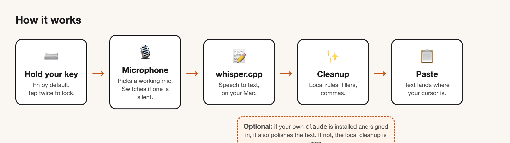
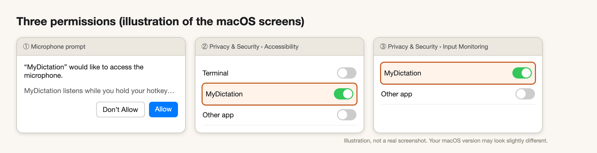
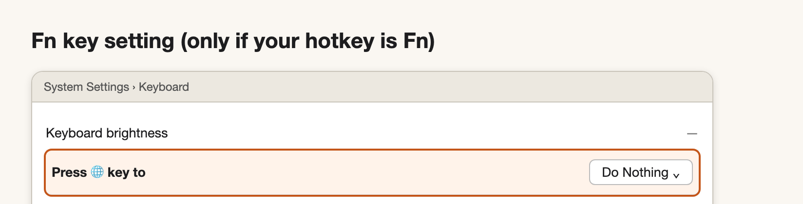
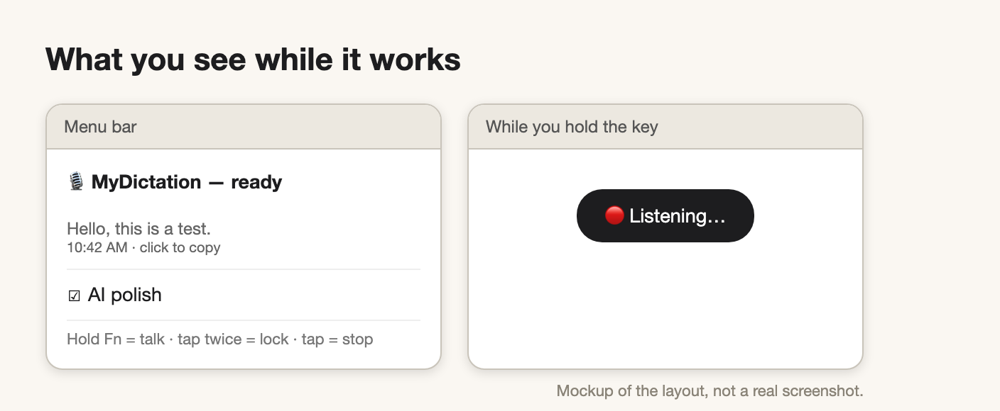

# Open Dictation

Hold a key. Talk. Your words appear where your cursor is.

A free dictation app for your Mac. It listens on your Mac, turns speech into text on your Mac, and pastes it into any app. No account. No subscription. You pick the name and the language.

Made by Kuba Slomczewski · Instagram [@kub.ski](https://instagram.com/kub.ski)



## The easy way: let your AI do it

Already use Claude Code (or a similar coding agent)? Paste the prompt from [PROMPT.md](PROMPT.md). It asks you three questions, installs everything, and walks you through the Mac permission screens.

> **Prompt (short version):** "Clone https://github.com/kub-ski/open-dictation, ask me for an app name, my language and my hotkey, run `./setup.sh` with my answers, then walk me through the macOS permissions one at a time. I am not technical."

## What you need

- A Mac with Apple Silicon (M1 or newer)
- macOS 14 (Sonoma) or newer
- About 1 GB of free space
- Optional: the [`claude` CLI](https://docs.claude.com/en/docs/claude-code) signed in. If you have it, the app can also polish your text. If you don't, everything still works.

## Install in 5 steps

1. Open **Terminal** (press ⌘ Space, type "Terminal", press Enter).
2. Download the code:
   ```bash
   git clone https://github.com/kub-ski/open-dictation.git
   cd open-dictation
   ```
3. Run the setup:
   ```bash
   ./setup.sh
   ```
4. Answer 3 questions: the **name** of your app, your **language** (`auto` finds it for you), and your **hotkey** (`fn` is the default). Press Enter to accept a default.
5. Wait. The first run installs the tools, downloads a speech model (about 470 MB), and builds the app. When it ends, the app opens and a microphone icon shows in your menu bar.

Setup is safe to run again. It skips what is already done. Run it again any time you want a new name, language or hotkey.

Prefer no questions? `./setup.sh --name "Whisperer" --language auto --hotkey fn --yes`

## Allow the permissions

macOS asks for three permissions. Each one is a one-time step. Do them in this order.



1. **Microphone.** Click **Allow** when the pop-up appears.
2. **Accessibility.** Open System Settings › Privacy & Security › Accessibility. Switch your app **on**. (This lets the app paste for you.)
3. **Input Monitoring.** Open System Settings › Privacy & Security › Input Monitoring. Switch your app **on**. (This lets the app notice your hotkey.)

Then quit the app from its menu-bar icon and open it again from `~/Applications`.

**If your hotkey is Fn,** also do this once:



System Settings › Keyboard › **Press 🌐 key to** › **Do Nothing**. Without it, macOS opens the emoji picker or its own dictation when you press Fn.

## Use it



- **Hold** your hotkey and talk. Let go. The text is pasted.
- **Tap twice** to lock the recording on (for long talking). **Tap once** to stop.
- Say **"new line"**, **"new paragraph"**, **"comma"**, **"question mark"** and the app types the mark instead of the words.
- Click the menu-bar icon to see your last dictations, copy one, or open the full history.

## Settings

Your settings live in `~/.<yourname>/config.json`. Edit it, then quit and reopen the app.

| Setting | Values | Default |
|---|---|---|
| `language` | `auto`, or a Whisper code: `en`, `pl`, `de`, `es`, `fr`… | `auto` |
| `pack` | `en` or `pl`: cleanup rules for filler words and spoken commands | `en` |
| `hotkey` | `fn`, `right-option`, `right-command`, `right-control`, `left-control` | `fn` |
| `aiPolish` | `auto` (use `claude` if it is signed in), `on`, `off` | `auto` |
| `model` | the model file in `~/.<yourname>/models/` | `ggml-small.bin` |

**Better accuracy:** `./setup.sh --model medium` (about 1.5 GB) or `--model large-v3-turbo` (about 1.6 GB, best, needs a faster Mac).

**Another language pack:** add one entry to `Sources/OpenDictation/LanguagePack.swift` (filler words, spoken commands) and run `./setup.sh` again.

## How it works

1. A global key listener sees your hotkey.
2. The microphone records. If a mic gives only silence (some headsets do), the app switches to the next mic by itself.
3. `ffmpeg` converts the audio. `whisper.cpp` turns it into text, on your Mac.
4. A fast local cleanup removes "um" and "uh", fixes spaces and capital letters, and applies spoken commands.
5. Optional: your own `claude` CLI polishes the text. If it is missing, signed out, or answers with something that is not a cleanup, the local text is used.
6. The text is pasted with ⌘V. Your old clipboard is put back.

## Troubleshooting

**Nothing happens when I hold the key.**
Check Input Monitoring and Accessibility (both on). If your key is Fn, check the "Press 🌐 key to: Do Nothing" setting. Then quit and reopen the app.

**It asks for permissions again after I rebuilt it.**
macOS ties permissions to how the app is signed. `setup.sh` makes a signing identity called "<Name> Self-Signed" so permissions survive rebuilds. If you ever see "signed ad-hoc" in the build output, run `./setup.sh` again. To reset: remove the app from both Privacy lists with the **−** button, open it again, and allow again.

**"No sound from … — using …" appears, or nothing was recorded.**
The app tried a mic that was silent and moved to the next one. That is the safety net working. Bluetooth headsets that are busy with another device are the usual cause. The built-in mic is skipped when a laptop lid is closed, because macOS feeds it silence then. Pick a working mic in System Settings › Sound › Input.

**The text is wrong or in the wrong language.**
Set `language` to your language (for example `en`) instead of `auto`, or use a bigger model. Short phrases are the hardest for any speech model.

**The first dictation is slow.**
The model loads into memory the first time. After that it is faster.

**"Homebrew could not install …"**
If it says `/opt/homebrew is not writable`, run the `sudo chown` line it prints, then `./setup.sh` again.

**Where is the log?**
`~/.<yourname>/logs/app.log`. Every step writes a line with its timing.

**Leftover audio.**
A normal recording deletes itself. Leftovers from a crash are removed after 24 hours.

## Check that it works (no microphone needed)

```bash
~/Applications/<YourName>.app/Contents/MacOS/<YourName> --check
```

It runs the cleanup rules and the settings reader, prints PASS or FAIL for each, and exits.

## Privacy

Audio and text stay on your Mac. The only network use is the one-time model download and Homebrew. If you turn on AI polish, the text of each dictation goes to Claude through your own `claude` login, the same as any message you send there.

## License and credit

MIT. See [LICENSE](LICENSE). Use it, change it, share it.

Made by Kuba Slomczewski · Instagram [@kub.ski](https://instagram.com/kub.ski)

Built on [whisper.cpp](https://github.com/ggml-org/whisper.cpp) and [ffmpeg](https://ffmpeg.org).
